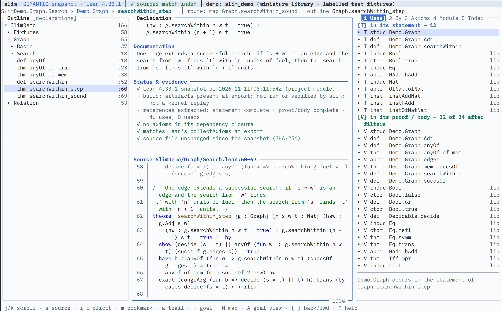
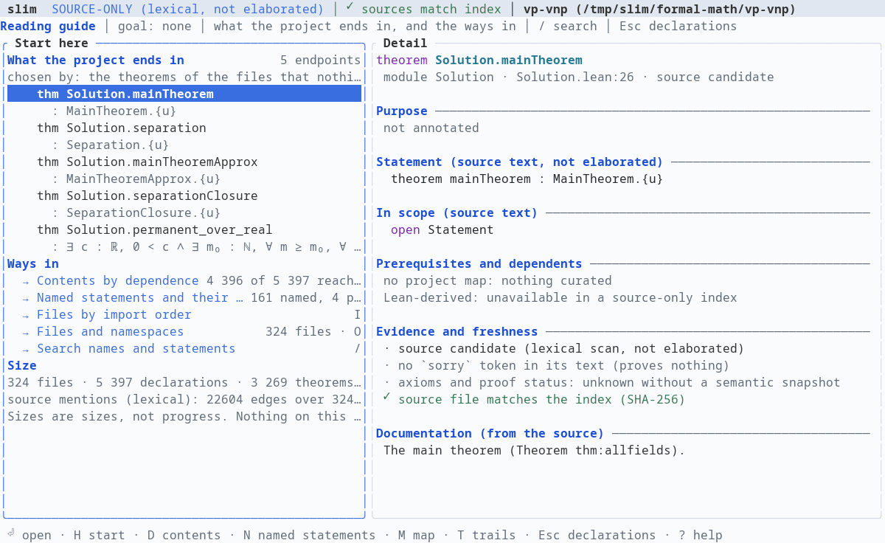

<h1 align="center">
  <picture>
    <source media="(prefers-color-scheme: dark)" srcset="assets/logo/slim-dark.svg">
    
  </picture>
</h1>

<p align="center">
  <picture>
    <source media="(prefers-color-scheme: dark)" srcset="assets/screenshots/slim-dark.png">
    
  </picture>
</p>

A fast terminal navigator for **reading** large Lean 4 projects: find a theorem, read its
statement, documentation and source, follow what it depends on and what depends on it, and get
the big picture of a project through a curated map, statement-only skims and the import order.
Editing and developing proofs stays in your editor.

slim is not a proof checker. It never claims a theorem is "proved"; it shows evidence and where
that evidence came from.

## Download

Prebuilt binaries for Linux are attached to the
[v0.1.0 release](https://github.com/tzu-chen/slim/releases/tag/v0.1.0), a preview: `x86_64` for
64-bit Intel/AMD and `aarch64` for 64-bit ARM. They need glibc 2.34 or newer and do not run on
Alpine/musl. There are no macOS or Windows binaries yet.

```sh
name=slim-v0.1.0-$(uname -m)-unknown-linux-gnu
curl -LO https://github.com/tzu-chen/slim/releases/download/v0.1.0/$name.tar.gz
tar -xzf $name.tar.gz
./$name/slim demo
```

Each archive has a `.sha256` file beside it on the release page. The rest of this README is
written for a source checkout: where a command says `./target/release/slim`, use the extracted
`slim`, and the YM example also needs `examples/YM/lean-view.toml` from this repository.

## Build

To build from source instead you need a Rust toolchain (tested with rustc 1.99.1) and a C
compiler (for the bundled SQLite and Oniguruma). Dependencies are pinned in `Cargo.lock`.

```sh
git clone https://github.com/tzu-chen/slim.git && cd slim
cargo build --release
```

The binary is `target/release/slim`; put that directory on your `PATH` or copy the file. Nothing
else is needed to read a project: no Lean installation, no Lake, no network.

## Run the demo

```sh
./target/release/slim demo
```

This opens a miniature Lean library that is embedded in the binary together with its semantic
data (real output of Lean 4.33.1), so it needs no Lean, no network and no compilation. It opens
on the library's map.

| Key | |
|---|---|
| `j` `k` | move |
| `Enter` | open the selected declaration |
| `/` | search by name or by words from the documentation |
| `1` `2` `3` | what a declaration uses, what uses it, its axioms with evidence paths |
| `Backspace` | go back |
| `?` | every key |
| `q` | quit |

## Read a new proof top down

For a proof you have never seen, slim builds a **reference graph** of the whole project and
reads it for you: what the project ends in, its contents ordered by how much rests on each
step, the named statements and the theorems that prove them, why a declaration is there, and
any statement with the project's own vocabulary unfolded under it.

[anthropics/formal-math](https://github.com/anthropics/formal-math) has the Lean proof that
VP ≠ VNP over every field:

```sh
git clone https://github.com/anthropics/formal-math.git    # about 10 MB; nothing is built
./target/release/slim graph build formal-math/vp-vnp       # reads files; runs nothing
./target/release/slim formal-math/vp-vnp
```

<p align="center">
  <picture>
    <source media="(prefers-color-scheme: dark)" srcset="assets/screenshots/reading-dark.gif">
    
  </picture>
</p>

It opens on the five theorems the project ends in. `Enter` opens `Solution.mainTheorem`,
and `u`, `u` unfolds its statement down to Mathlib's vocabulary (`*` then pins it as the goal,
`D` lists what it rests on, and `W` on a row shows why that row is there):

```
  then  MainTheorem.{u}
        │ def MainTheorem : Prop :=  (Statement.lean:44)
        │   ∃ c : ℝ, 0 < c ∧ ∀ p : ℕ, ∃ m₀ : ℕ, ∀ (F : Type u) [Field F] [CharP F p], ∀ m ≥ m₀, ∀ s : ℕ,
        │     (Computes (hc F m) s → Beyond c m s) ∧ (p ≠ 2 → Computes (perm F m) s → Beyond c m s)
            │ def Computes {R : Type u} {V : Type} [CommSemiring R] (f : MvPolynomial V R) (s : ℕ) : Prop :=  (Statement.lean:23)
            │   …
            │ def Beyond (c : ℝ) (m s : ℕ) : Prop := (m : ℝ) ^ (c * Real.logb 2 m ^ (1 / 3 : ℝ)) < s  (Statement.lean:39)
```

| Key | |
|---|---|
| `H` | start page: what the project ends in, and the ways in |
| `D` | contents by dependence: what the endpoints rest on, largest parts first |
| `N` | named statements and the theorems that prove them |
| `W` | why is this here: a chain of references from an endpoint to the current declaration |
| `u` `U` | unfold the project's names in a statement, one level more or less |
| `C` | search: all matches, those the endpoints reach, the rest |

Without a build the references are lexical and every screen says so; after `lake build` in
the project, slim reads Lean's own reference files. These views are in slim 0.2.0 and
later: the v0.1.0 binaries under Download do not have them, a build from source does. The guide has the
[session](docs/guide.md#a-new-proof-read-top-down-vp--vnp), and `docs/reading.md` the details.

## Try it on a real project

The public [YM repository](https://github.com/yang-mills-group/YM) has 9,564 Lean files, and
slim ships a project map for it in `examples/YM/lean-view.toml`:

```sh
git clone https://github.com/yang-mills-group/YM.git      # about 160 MB; nothing is built
./target/release/slim YM --map examples/YM/lean-view.toml
```

The first start scans the `.lean` files as text (about a second) and keeps its index in
`~/.cache/slim`, never in the checkout. It runs no Lean and no project code. slim opens on the
map: `j`/`k` move, `Enter` opens, `*` pins a goal and `A` unfolds the map's argument for it,
`S` skims the selected component, `T` lists reading trails.

The YM map is an example of the format, drafted by an AI assistant and not accepted by anyone;
slim marks every entry of it as a suggestion. It is a reading aid, not a statement about the
mathematics.

## Where to go next

The [user guide](docs/guide.md) continues from here:

* [a step-by-step first session on YM](docs/guide.md#a-first-session-on-a-real-project-ym)
* [tours of the demo](docs/guide.md#the-bundled-demo) and of [its map](docs/guide.md#the-demos-map)
* [opening your own projects](docs/guide.md#your-own-projects), source-only or with Lean's own
  dependency data
* [what slim runs, and what it never runs](docs/guide.md#trust-and-execution-boundaries)
* [supported Lean toolchains](docs/guide.md#supported-lean-toolchains),
  [every command](docs/guide.md#commands) and [the other documents](docs/guide.md#other-documents)

## License

Apache-2.0, see [LICENSE](LICENSE). Bundled third-party grammars and themes and their licences
are listed in [THIRD-PARTY-NOTICES.md](THIRD-PARTY-NOTICES.md).
